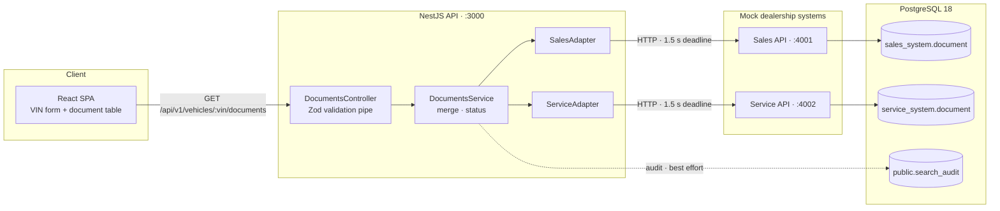
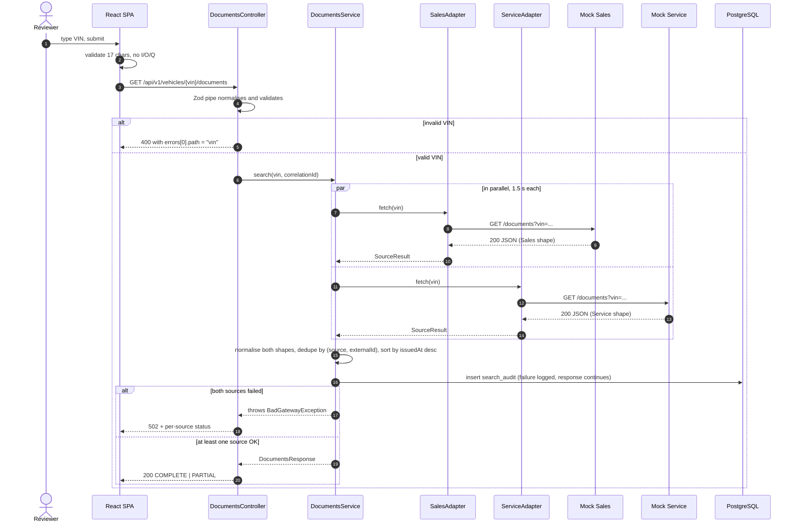
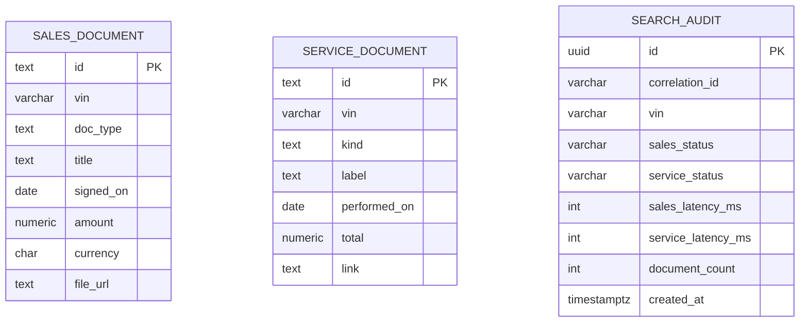

# System Design — Unified Document Viewer

Scenario D: one VIN search returns every document a dealership holds for that
vehicle, merged from two independent systems (Sales and Service) and labelled
with the source of each row.

This document is the architectural plan. The feature contract lives in
[RFC-0001](rfc/0001-documents-aggregation.md); the exact HTTP shapes live in
[the API contract](contracts/documents-api.md).

## 1. Scope

**In scope**

- One search entry point: a VIN typed by the user, validated on both sides.
- Parallel calls to two mocked upstream systems with independent deadlines.
- One normalised document list, sorted, with a source label per row.
- Partial-failure semantics: one source down still returns the other's data.
- An audit row per search.

**Out of scope**

- Writing or caching documents. Upstream systems own them (ADR-0003).
- Authentication, multi-tenancy, pagination, file download.
- A message broker, a second service, or a client-side store.

The boundary is deliberate: the brief asks for an aggregator, not a document
management system.

## 2. Architecture

The diagram reads left to right because the domain is **wide, not deep**: one
client, one API, two independent upstream owners, one database. Putting the two
upstream systems side by side is what shows the shape of the problem — the API
is a join point, not a hierarchy.

*Figure 1 — Container view. The API talks to the upstreams over HTTP only; it
never joins their schemas.*

| Component | Responsibility | Why it is separate |
| --- | --- | --- |
| React SPA | VIN form, validation, loading/empty/partial states, one row per document with a source tag | Rendering only; no business rule beyond input shape |
| `DocumentsController` | Validates `:vin`, delegates; errors surface as `400` from the pipe and `502` from the service | HTTP concerns stay out of the service |
| `DocumentsService` | Fan-out, normalise, dedupe, sort, derive `COMPLETE`/`PARTIAL`, record audit | The only place that knows both sources exist |
| `SalesAdapter` | Calls Sales, maps its payload shape, classifies failures | Payload shape is owned by Sales; the domain is not |
| `ServiceAdapter` | Same for Service, with a different payload shape | Proves normalisation is real, not assumed |
| Mock Sales / Mock Service | Two HTTP servers reading their own schema, with `?fail` and `?delay` | Simulate systems we do not own |
| PostgreSQL | `sales_system`, `service_system` (fixtures) and `public.search_audit` (ours) | One database, three owners, three schemas |

The API also exposes `GET /api/health` (readiness: database round-trip) and
`GET /api/health/live` (liveness: process only). The liveness endpoint is the
Docker health check; readiness is for an operator or a load balancer.

## 3. Data flow

*Figure 2 — One search. The two upstream calls run concurrently; one slow source
cannot delay the other beyond the deadline.*

| Step | What happens | Where |
| --- | --- | --- |
| 1 | User submits a VIN | `VinSearchForm` |
| 2 | Client-side validation blocks an invalid VIN before any request | `features/documents/utils/vin.ts` |
| 3 | Request reaches the controller; the pipe normalises (trim, upper-case) and validates again | `zod-validation.pipe.ts` |
| 4 | Service starts both adapter calls with `Promise.allSettled` | `documents.service.ts` |
| 5 | The shared upstream client applies a per-call `AbortSignal.timeout`; each adapter parses its payload with Zod | `adapters/upstream-client.ts`, `adapters/*.adapter.ts` |
| 6 | Results are merged: prefix `id` with the source, drop duplicates inside a source, sort by `issuedAt` descending | `documents.service.ts` |
| 7 | Status is derived from how many sources returned `OK` | `documents.service.ts` |
| 8 | Audit row is written best-effort | `search-audit.repository.ts` |
| 9 | Response carries `vin`, `documents`, `meta.status`, `meta.sources`, `meta.durationMs` | `contracts/documents-api.md` |

## 4. Data model

Three schemas, three owners. There is no foreign key between them on purpose:
the mock schemas belong to other systems, and the API is not allowed to join
them (ADR-0003).

*Figure 3 — `sales_system.document` (7 seed rows), `service_system.document`
(5 seed rows), and the one table this service owns.*

| Table | Owner | Notes |
| --- | --- | --- |
| `sales_system.document` | Sales system | `doc_type` in `CONTRACT`, `INVOICE`, `WARRANTY`; money as `numeric(12,2)` + `char(3)` |
| `service_system.document` | Service system | Different names on purpose: `kind`, `label`, `performed_on`, `total`, `link` |
| `public.search_audit` | This service | One row per search: correlation id, VIN, both source statuses, both latencies, document count |

Both document tables index `vin`. `search_audit` indexes `(vin, created_at desc)`
for history and `correlation_id` to join a log line to a search.

A document id is source-scoped (`SALES:SL-2024-001`). The same real-world
invoice appearing in both systems is **not** merged: without a shared business
key, equality cannot be proven, and a wrong merge is worse than a duplicate row.
Dedupe therefore only removes repeats inside one source.

## 5. Failure semantics

| Situation | Upstream status | HTTP | Body |
| --- | --- | --- | --- |
| Both sources answer with valid payloads | `OK` / `OK` | 200 | `meta.status = COMPLETE` |
| One source fails, the other answers | `OK` / `ERROR` (or reverse) | 200 | `PARTIAL`, `meta.sources` names the failure |
| Both sources fail | `ERROR` / `ERROR` | 502 | `{ statusCode, message, sources }` |
| Upstream exceeds 1.5 s | `TIMEOUT` | 200 if the other is `OK`, else 502 | as above |
| Upstream returns 2xx with the wrong shape | `INVALID_PAYLOAD` | 200 if the other is `OK`, else 502 | as above |
| VIN invalid | not called | 400 | `errors[0].path = "vin"` |
| Audit insert fails | unchanged | unchanged | response still returns; warning logged |

Rules behind the table:

- **One source is not an outage.** Downstream systems fail independently, so a
  single failure degrades the answer instead of hiding it.
- **Both down is an outage.** There is nothing to show, and a `200` with an empty
  list would be a lie.
- **Audit is evidence, not a dependency.** Losing an audit row is a warning, not
  a failed search.
- **Validation runs before fan-out.** An invalid VIN never costs two upstream
  calls.

## 6. Technology choices

| Layer | Choice | Alternative considered | Why this one |
| --- | --- | --- | --- |
| API | NestJS 12 (ESM) | Express | Modules, DI and pipes make the adapter boundary explicit; Swagger is generated from decorators |
| Validation | Zod 4 | class-validator | One schema yields both the runtime check and the TypeScript type; no duplicated DTO class |
| Database access | Prisma 7 | raw `pg` / Kysely | Migrations plus a typed client for the one table we own; raw SQL would be more code, not less |
| Database | PostgreSQL 18 | SQLite | Schemas model three owners in one instance; SQLite has no schema namespace |
| Client | React 19 + Vite 8 | Next.js | One screen, no SSR or routing requirement; Vite keeps the build small |
| UI | Ant Design 6 | Tailwind + headless | Table, tags, alerts and the empty state are accessible by default; theming stays in tokens, not hand-written CSS |
| Server state | TanStack Query 5 | `useEffect` + `useState` | Per-VIN cache, loading and error states for free; retry is disabled so a failure is shown once |
| Tests | Vitest + Supertest + Playwright | Jest | One runner across BE and FE; Playwright covers the real stack in Docker |
| Tooling | Biome 2 | ESLint + Prettier | One binary, one config, same rules for both apps |

Deliberately rejected: microservices, Kafka, Redis, GraphQL, WebSockets. Each
adds an operational surface the scenario does not need, and the brief grades a
REST API.

## 7. Observability

### Implemented

| Signal | How | What it answers |
| --- | --- | --- |
| Structured logs | `pino`, one line per request (JSON in production) | What happened, to which route, with what status and duration |
| Correlation id | `x-correlation-id` reused if sent, generated with `randomUUID()` otherwise, echoed in the response | Which log lines and which `search_audit` row belong to one search |
| Request timing | `responseTime` on every log line; per-source latency in the audit row | Is the API slow, or is one upstream slow |
| Search audit | `public.search_audit` row per search, written best-effort | Volume, VINs searched, per-source health over time |
| Readiness | `GET /api/health` runs `SELECT 1` with a 2 s timeout | Can this instance serve traffic |
| Liveness | `GET /api/health/live` never touches the database | Is the process alive, independent of Postgres |
| Container health | Docker health checks for all four services; `api` waits for the other three | Did the stack start in the right order |

### Not built, and why

| Signal | Why not now | Trigger to add it |
| --- | --- | --- |
| Metrics (counters, histograms, error rate) | One instance, no dashboard or SLO to alert on; the audit table already answers "how often does a source fail" | A second instance, or an SLO that needs alerting |
| Distributed tracing | The request crosses one service boundary; the correlation id is enough to follow it | A second owned service, or a queue |
| Log aggregation | Logs are read with `docker compose logs`; there is no cluster | More than one host |

The line is deliberate: observability is added when it answers a question
someone actually asks. The correlation id is the one piece that would be
expensive to retrofit, so it exists from day one.

## 8. How GenAI was used in the design phase

**Strategy.** The work was split before any code was written. The scenario and
stack were fixed first; the assistant then drafted the RFC, the three ADRs, the
API contract and the phase plan. Each document had to state its assumptions and
its failure behaviour, not just its happy path. The human set the constraints
that the assistant was not allowed to renegotiate: two mocked systems, audit-only
persistence, no extra infrastructure.

**Division of labour.**

| Activity | Assistant | Engineer |
| --- | --- | --- |
| Scenario and stack selection | Proposed options with trade-offs | Chose Scenario D, NestJS/React/Postgres |
| Data ownership | Drafted ADR-0003 | Rejected any document cache |
| Failure model | Enumerated timeout, non-2xx, malformed payload, both-down cases | Chose `PARTIAL` + `502` semantics |
| API shape | Drafted contract, status codes, source status enum | Approved the response fields |
| UI direction | Implemented the screen | Set the visual direction, rejected the first layout |
| Verification | Ran lint, type check, unit, e2e, Docker and browser tests | Accepted only results backed by command output |

**Verification loop.** A design statement was treated as a claim until a command
confirmed it. Three examples from this project:

1. The frontend showed duplicate validation messages. The fix was driven by a
   failing component test, not by reading the form code.
2. `npm run dev` started the API container and then failed to bind port 3000.
   Reproduced with a real bind attempt, then the script was split so local mode
   leaves that port to the local process.
3. Local mode returned `502` because the Docker mocks were not reachable from
   the host. The fix was one published port per mock, verified by a request that
   returned `COMPLETE` with six documents afterwards.

**What was not delegated.** The assistant did not decide the persistence
boundary, the partial-failure contract, or the visual direction. Those were
reviewed and changed by the engineer, and the documents were updated in the same
change when the code disagreed with them.

## 9. Assumptions

1. The two dealership systems are independent owners; the API may call them over
   HTTP but never read their schemas directly.
2. A VIN is 17 characters, excludes `I`, `O`, `Q`, and is case-insensitive.
3. Each upstream answers within 1.5 s at p99; slower is treated as unavailable.
4. Source ids are stable and unique inside their own system.
5. The same document may exist in both systems under different ids, and is kept
   twice rather than guessed to be equal.
6. The audit table may lose a row without failing the search.
7. One reviewer runs the stack locally; no horizontal scaling is required.
8. Mock data is loaded once by a documented seed command (README quick start).

## 10. Future work

Ordered by the trigger that would justify each item, not by ambition:

| Change | Trigger |
| --- | --- |
| TTL cache keyed by VIN | Upstream latency becomes the bottleneck; requires a new ADR that supersedes ADR-0003 |
| Retry with jitter on `TIMEOUT` only | A source shows transient timeouts in `search_audit` |
| Circuit breaker per source | A source fails for minutes at a time and the deadline is wasted on every call |
| Metrics and tracing | A second instance or a second owned service appears |
| Pagination | A VIN can return hundreds of documents |
| Authentication | The API leaves the assessment environment |
